# screen-mark

Screenshot capture and annotation in pure Rust

<picture>
  <source media="(prefers-color-scheme: dark)" srcset="docs/assets/cover-dark.svg">
  
</picture>

Windows: download `screen-mark-vX.Y.Z-windows-x64.msi` (installer) or `.zip` (portable) from [Releases](https://github.com/Real-Fruit-Snacks/screen-mark/releases/latest). Linux: `screen-mark-vX.Y.Z-linux-x64.tar.gz` from the same page. Or build it:

```sh
cargo install --git https://github.com/Real-Fruit-Snacks/screen-mark --locked
```

I wanted a screenshot tool that starts in under a second, draws an arrow without a round trip through a web view, and leaves no background service I didn't ask for. This is that: `winit` for windows, `tiny-skia` for drawing, a tray icon, three global hotkeys, and a TOML file. It assumes Windows 10 or later; on Linux it captures under X11, and under Wayland through the desktop's screenshot portal.

## What's in it

| Command | Does |
|---|---|
| `screen-mark` | Starts in the tray. `Ctrl+PrintScreen` saves a PNG of the monitor under the mouse and copies it, in one press. `Ctrl+Shift+S` opens the capture overlay. `Shift+PrintScreen` captures the last region again |
| `screen-mark capture --clipboard` | Captures the full screen to the clipboard, no UI |
| `screen-mark capture --save out.png` | Captures the full screen to a file, no UI |
| `screen-mark capture --delay 5` | Counts down five seconds on screen, then opens the overlay; with a flag above, captures instead |
| `screen-mark edit photo.png` | Opens an image file to mark up; with no file, the image on the clipboard |
| `screen-mark install` / `uninstall` | Copies the exe to AppData with a Start Menu entry and PATH; the portable exe asks before doing this |
| `screen-mark update` | Looks for a newer release and installs it; `--check` only looks. See [Updating](#updating) |

The one-press screenshot saves to `Pictures\screen-mark` (or the folder you pick in Settings › Capture) under a timestamped name that never overwrites, then puts the same image on the clipboard. `Shift+PrintScreen` does the same for the area of the last region you captured, so a window or a chart you capture every day is one key; screen-mark remembers that area across restarts. A small popup in the corner says what happened; click it to open the folder with the file selected. Settings › Capture can switch the popup to system notifications or turn it off; errors always show.

In the overlay: drag for a region, click for a window, `Escape` cancels. `Enter` or `Ctrl+C` copies the selection with annotations, `Ctrl+S` saves, `Ctrl+Z` / `Ctrl+Shift+Z` undo and redo, scroll wheel changes tool size. From the toolbar: pin the capture as an always-on-top window, upload it anonymously to Imgur (needs your own client ID, see Configuration), run Windows OCR on it and copy the text, or hand it to a command of your own (see [Send](#send)). Two switches in Settings › Capture change the region flow: *Save a file every time I copy* writes a PNG alongside each copy, and *Copy as soon as a region is drawn* skips the markup toolbar so drag-and-release is the whole job.

For pixel-exact work a magnifier follows the pointer while you place the region, and the arrow keys move the pointer one pixel at a time (ten with `Shift`). Once a region exists the arrows move it and `Ctrl`+arrows resize it; with an annotation selected they move that instead. Hold `Shift` while dragging for a square region, squares, circles, and lines at 15° steps.

Fifteen annotation tools, one key each:

| Key | Tool | Key | Tool |
|---|---|---|---|
| `V` | Select / move | `H` | Highlight (multiply blend) |
| `A` | Arrow | `F` | Spotlight |
| `R` | Rectangle | `T` | Text (`Shift+Enter` new line, `Ctrl+V` pastes) |
| `C` | Circle | `B` | Pixelate |
| `O` | Rounded rectangle | `N` | Step marker, auto-numbered |
| `L` | Line | `I` | Eyedropper |
| `P` | Pencil | `M` | Measurement |
| `X` | Redact (solid box) | | |

Rectangles, circles, rounded rectangles, lines and arrows can be drawn as an outline, dashed, or filled (lines and arrows have no filled kind). `D` or the style button next to the colours switches between them; with a shape selected, it changes that shape. `shape_style` in the config picks the style each capture starts with.

Redact is the one for passwords and addresses: Pixelate keeps an average of what is under it, Redact keeps nothing. While typing text, `Enter` finishes, the arrow keys, `Home` and `End` move the caret, and a click anywhere else finishes the text and carries on. Characters the built-in font lacks (Chinese, Japanese, Korean and so on) are drawn with a font from the system.

Every key above is rebindable in Settings › Keys: click a binding, press the new combination. `Esc` cancels, `Backspace` leaves it unbound. Settings refuses a combination another binding already uses, one Windows keeps for itself (`Alt+Tab`, `Win+L`, ...), or a global hotkey another app has registered, and says which. A global hotkey with a single modifier (`Alt+S`) or a bare F-key is allowed, with a note that other apps won't see it while screen-mark runs. Pin, upload, OCR and Send start unbound and can be given keys there too.

Settings and History work without a mouse: `Tab` or the arrow keys move between controls, `Enter` or `Space` presses one, `Ctrl+Tab` changes tab, `Ctrl+Enter` saves. On Windows both windows are described to screen readers.

Dark and light modes, switched in Settings › General or with `theme` in the config file. Five annotation color presets (red, blue, green, yellow, mauve) or any `#rrggbb`.

### Marking up an image you already have

*Mark up an image...* in the tray menu opens a PNG, JPEG, WebP or BMP file in the same editor, and *Mark up the clipboard image* takes whatever image was copied last. `screen-mark edit photo.png` does the first from a terminal, and `screen-mark edit` the second. The image opens in the middle of the screen, selected; shrink the selection to crop it. Save suggests `photo (marked up).png`, so the original isn't overwritten by accident. An image bigger than the screen is shown, copied and saved at the size that fits.

### History

The last 20 captures are kept in the History window (tray menu). Click one to copy it again. The buttons along the bottom act on the one clicked last: *Copy*, *Mark up* to open it in the editor again, *Save as...*, *Show in folder*, and *Delete*. A capture copied, saved, pinned, uploaded or sent with annotations on it keeps them, so *Mark up* brings back the arrows and text as they were, to move, restyle or fix, not a flat picture. From the keyboard, with a capture focused: `Enter` copies, `E` marks up, `S` saves as, `O` shows it in its folder, `Delete` deletes. History lives in `%LocalAppData%\screen-mark\history` (Windows) or `~/.local/share/screen-mark/history` (Linux), never in a roaming profile; *Keep the last 20 captures in History* in Settings turns it off.

### File names

Captures are saved as `screen-mark_2026-11-11_143012.png` unless `file_name` in the config says otherwise, and never overwrite: a second capture in the same second gets `_2`. The placeholders are `{date}` (2026-11-11), `{time}` (143012), `{year}`, `{month}`, `{day}`, `{hour}`, `{minute}`, `{second}`, `{width}` and `{height}`; `file_name = "{date} bug report {width}x{height}"` gives `2026-11-11 bug report 1280x720.png`. Characters a file name can't hold become `-`. Settings › Capture shows what the next name will be.

### Send

Send hands the capture to a command of your own: an upload script, a copy to a share, a chat tool's command line. Set `command` under `[send]` and a Send button appears on the toolbar (give it a key in Settings › Keys):

```toml
[send]
command = "curl -s -F file=@{file} https://paste.example/upload"
name = "Paste"   # what the button and popups call it; "Send" if empty
```

The capture is written to a PNG in a temporary folder and `{file}` is replaced by its path; with no `{file}`, the path goes last. The command line is split like a shell would (`"..."` and `'...'` keep spaces) but no shell runs it, so for pipes or `&&` run one yourself: `sh -c '...' {file}` or `cmd /C ...`. Whatever the command prints is copied, so a script that prints a link leaves the link on the clipboard. A command that fails shows its exit code and last line of output; one still running after two minutes is stopped. The temporary PNGs are removed after a day.

## Updating

screen-mark contacts nothing unless you ask it to. *Check for updates* in the tray menu, or `screen-mark update --check`, asks GitHub for the newest release. If there is one, the same menu item becomes *Install screen-mark X.Y.Z*: it downloads the release, puts it in place and restarts. `screen-mark update` does the same from a terminal.

*Check for a new version once a day* in Settings › General (`auto_check` in the config) looks a minute after screen-mark starts and once a day after that. It tells you when there is a new version and installs nothing by itself.

What gets installed is checked four ways:

- The release's `latest.json` has to carry an Ed25519 signature made with one of two keys compiled into screen-mark (`src/update/keys.rs`). Where it was downloaded from doesn't count for anything.
- Each download has to have the size and SHA-256 that signed file gives.
- The new program is run once, to see that it starts and is the version the release says, before it replaces the old one.
- A release that isn't newer than the running one is never installed.

The version that was replaced stays beside the new one, as `screen-mark.old.exe`, until the new one has started.

How a copy updates depends on how it was installed. One screen-mark installed itself, or one unpacked from the zip or tar.gz, has its program file replaced. One installed with the MSI runs the new MSI, so Windows' list of installed apps stays right. A copy from Scoop, winget or Chocolatey, or in a folder screen-mark can't write to, is left alone: screen-mark says there is a new version and leaves installing it to the package manager, or to you.

To update from somewhere other than GitHub, set `url` under `[updates]` to a web folder or a folder path that holds `latest.json`, `latest.json.sig` and the release's downloads. A folder or share can also be picked with *Folder* next to *From* in Settings › General, and *GitHub* goes back. The signature is checked the same way, so plain `http://` or a file share is fine. `screen-mark update --from <folder or URL>` updates from somewhere else once, without changing the setting.

Behind a proxy, updates use the one in `HTTPS_PROXY` / `HTTP_PROXY` (with `NO_PROXY`) or, on Windows, the one in Settings › Network & internet › Proxy. A proxy that a setup script (PAC) or automatic detection provides isn't read: put it in `proxy` under `[updates]` (`proxy = "http://proxy.example:8080"`), or `proxy = "none"` to go direct. Connections to GitHub are checked against the certificates built into screen-mark, not the ones Windows trusts, so a network that inspects HTTPS breaks them; on one of those, serve updates from an internal `http://` folder or a file share instead.

## Tested on

- Windows 11 · Rust stable — my daily machine, every release used in anger before tagging
- Windows Server 2025 · Rust stable — CI (`windows-latest`) builds, tests, and runs clippy on every push
- Ubuntu 24.04 · X11 · Rust stable — CI (`ubuntu-latest`) builds and tests, then drives the real binary on a virtual X display with two monitors (`tests/e2e/`): hotkeys, popups, rebinding, the tray menu, unwritable folders, system notifications
- Wayland: capture goes through the desktop's screenshot portal and is tested against a stand-in for it on CI, not yet on a real GNOME or KDE session. macOS — does not build.

## Known issues

- Upgrading from HydroShot 1.x: config, history, and the autostart entry are migrated on first run. The old self-installed copy is not removed; run `hydroshot uninstall` once, or let the 2.0 MSI replace the 1.x MSI.
- Linux capture is experimental; multi-monitor and HiDPI are not verified there.
- Wayland: screen-mark's windows run through XWayland, and the picture comes from the screenshot portal (`xdg-desktop-portal` with the GNOME, KDE or wlr backend), which may ask once whether screen-mark may take screenshots. Wayland gives no program global hotkeys, so bind a shortcut in the desktop's keyboard settings to `screen-mark capture` (or `screen-mark capture --save ~/Pictures/shot.png`). The picture is scaled to XWayland's screen size when the two differ, which loses detail with fractional scaling. `SCREEN_MARK_CAPTURE=x11` or `=portal` overrides the choice.
- OCR is Windows only. It uses the Windows.Media.Ocr engine, so a language with OCR has to be installed (Settings › Time & language). Small text (around 12 px and under) can come out with mistakes, and a very long, thin strip (roughly fifty times wider than tall) can come out empty.
- Typing with an input method (IME) in a text annotation is new in 2.2 and has had little real use yet.
- The updater is new in 2.3. Replacing the exe has been run end to end on Windows. Updating a copy installed with the MSI has only been run with a stand-in for the installer, and the Linux side only in tests.
- Screen readers get Settings, History and the capture overlay on Windows only. In the overlay they hear the toolbar's buttons, which tool and colour are on, and a status line (the selection's size, the tool, how many annotations, and the keys); placing a region still takes a mouse or the arrow keys.
- Imgur upload ships with no client ID. Register one at api.imgur.com and set it in Settings or `SCREEN_MARK_IMGUR_CLIENT_ID`.
- Window capture skips cloaked UWP windows on purpose; some Store apps will not be selectable by click.
- CLI `--save` writes PNG, JPEG, WebP or BMP, picked by the file extension; anything else is refused.
- `Ctrl+PrintScreen` and `Shift+PrintScreen` are already taken on some machines (Greenshot, ShareX, and some keyboard utilities register them; Greenshot uses `Shift+PrintScreen` for its own last region). screen-mark shows a popup when a hotkey can't be registered; click it to pick another in Settings › Keys.
- Linux: `screen-mark capture --clipboard` loses the image when the command exits, because X11 clipboards live in the owning process. The tray app's clipboard is fine.

## Offline and air-gapped use

Everything on the release page works with no internet access. Only Imgur upload and looking for updates need a connection, and neither happens unless you ask for it. Send runs only the command you set.

- **Windows:** the exe needs Windows 10 or later and nothing else, not even the Visual C++ Redistributable. The `.zip` and the MSI also carry this README, the changelog, the licence and `THIRD-PARTY-LICENSES.txt`.
- **Linux:** the binary uses the system's GTK 3, libxdo, the X11 part of libxkbcommon (for the keyboard) and an AppIndicator library for the tray. Without libxkbcommon-x11 it stops at start with "Library libxkbcommon-x11.so could not be loaded". On Ubuntu, install them with `sudo apt install libxdo3 libxkbcommon-x11-0 libayatana-appindicator3-1` (GTK 3 comes with the desktop) before going offline.
- **Updates:** copy a release's downloads, `latest.json` and `latest.json.sig` into one folder on an internal web server or a file share, and that folder can serve updates. Point screen-mark at it with `url` under `[updates]` (see [Updating](#updating)).
- **Checksums:** `SHA256SUMS.txt` lists the release's downloads. Check with `sha256sum -c SHA256SUMS.txt --ignore-missing` on Linux, or compare `Get-FileHash <file>` in PowerShell.

### Building with no internet

A release carries only the built downloads, so fetch the source and the crates it depends on while online, then carry the folder across:

```sh
git clone --branch vX.Y.Z https://github.com/Real-Fruit-Snacks/screen-mark
cd screen-mark
cargo vendor --locked vendor >> .cargo/config.toml
```

`cargo vendor` puts every crate in `vendor/` and the lines it adds to `.cargo/config.toml` point cargo there. Bring these onto the machine too:

- **Rust** 1.88 or later. The [standalone installers](https://forge.rust-lang.org/infra/other-installation-methods.html#standalone-installers) work offline.
- **Windows:** Visual Studio Build Tools with the *Desktop development with C++* workload. `vs_buildtools.exe --layout <folder>` makes an offline installer.
- **Linux:** `libgtk-3-dev libxdo-dev libxkbcommon-dev libwayland-dev libglib2.0-dev` (Ubuntu package names).
- **The MSI only:** `cargo-wix` and the WiX Toolset 3. Install `cargo-wix` while online (`cargo install cargo-wix`). The exe itself needs neither.

```sh
cargo build --release --offline
cargo test --offline
```

## Configuration

Written on first run to `%APPDATA%\screen-mark\config.toml` (Windows) or `~/.config/screen-mark/config.toml` (Linux). Every key is optional; missing keys take the defaults below. Set `SCREEN_MARK_HOME` to keep the config and history in one folder of your choosing instead (portable use; the test suite uses it too).

```toml
[general]
default_color = "blue"        # red | blue | green | yellow | mauve | "#rrggbb"
default_thickness = 3.0
save_directory = ""           # where captures go; empty means Pictures/screen-mark
ask_where_to_save = true      # Ctrl+S opens a PNG/JPEG/WebP dialog; false saves straight to the folder
                              # (left unset, it asks only while save_directory is empty)
copy_also_saves = false       # every copy also writes a PNG to save_directory
finish_on_release = false     # copy as soon as a region is drawn, no markup toolbar
magnifier = true              # magnified pixels beside the pointer while placing a region
screenshot_area = "monitor"   # monitor (under the mouse) | all
notifications = "toast"       # toast | system | off; errors always show
imgur_client_id = ""          # or SCREEN_MARK_IMGUR_CLIENT_ID in the environment
history_enabled = true
theme = "dark"                # dark | light
shape_style = "outline"       # outline | dashed | filled; D switches while marking up
file_name = "screen-mark_{date}_{time}"  # see File names

[hotkey]                      # global; "" leaves one unbound
region = "Ctrl+Shift+S"       # was `capture` in 2.0; that name still works
screenshot = "Ctrl+PrintScreen"
last_region = "Shift+PrintScreen"  # the last region's area again, saved and copied

[keys]                        # while marking up
copy = "Ctrl+C"
save = "Ctrl+S"
undo = "Ctrl+Z"
redo = "Ctrl+Shift+Z"
select_all = "Ctrl+A"
pin = ""
ocr = ""
upload = ""
send = ""                     # runs [send] command
style = "d"                   # outline / dashed / filled; one key, like a tool

[shortcuts]                   # one key per tool; defaults are the table above
select = "v"

[toolbar]                     # hide tools you never use
measurement = false

[updates]
auto_check = false            # look for a new release after starting and once a day; never installs by itself
url = ""                      # where releases are, when not GitHub: a web folder or a folder path
proxy = ""                    # empty: HTTPS_PROXY / NO_PROXY, then Windows' proxy setting; or "http://host:port", or "none"

[send]
command = ""                  # empty: no Send button. See Send
name = ""
```

The log is `%LocalAppData%\screen-mark\screen-mark.log` (Windows), `~/.local/share/screen-mark/screen-mark.log` (Linux), or `screen-mark.log` in `SCREEN_MARK_HOME`. When a capture can't start, the popup says why and a click on it shows the file. It holds messages and file paths, never image data, starts afresh at 1 MB, and keeps the one before as `.old`. `RUST_LOG=debug` makes it say more.

Source layout, for the curious: `src/capture/` has one backend per platform, `src/tools/` has one file per annotation tool, `src/overlay/` is the selection UI and what it does with the mouse and keyboard (`input.rs`, which `main.rs` only feeds events to), `src/state.rs` holds the annotation command stack that undo and redo replay, and `src/update/` is the updater. `docs/` is the [website](https://real-fruit-snacks.github.io/screen-mark/), deployed by `pages.yml` on every push to `main`; `.gitlab-ci.yml` does the same on GitLab for air-gapped hosting.

## License

MIT
