# screen-mark

Screenshot capture and annotation in pure Rust

<picture>
  <source media="(prefers-color-scheme: dark)" srcset="docs/assets/panel-dark.svg">
  
</picture>

```sh
cargo install --git https://github.com/Real-Fruit-Snacks/screen-mark --locked
```

- **Direct native binary:** Built with `winit` and `tiny-skia` — no web view, no background service, zero telemetry. Prebuilt Windows `.msi`/`.zip` and Linux `.tar.gz` binaries ship on [Releases](https://github.com/Real-Fruit-Snacks/screen-mark/releases/latest).
- **Three global hotkeys:** `Ctrl+PrintScreen` captures and copies the active monitor, `Ctrl+Shift+S` opens the region/window annotation overlay, and `Shift+PrintScreen` repeats the last region.
- **15 annotation tools + history:** Arrows, shapes, text, step markers, highlight, spotlight, pixelate, solid redact, magnifier, Windows OCR, pin-on-top, custom Send commands, and editable 20-capture history.
- **Offline & verified updates:** Works completely offline; opt-in `screen-mark update` verifies Ed25519 signatures and SHA-256 hashes before replacing itself.
- **Platforms:** Windows 10/11 (primary) and Linux (X11 + Wayland screenshot portal).

## Documentation

- [Project Page](https://real-fruit-snacks.github.io/screen-mark/)
- [Usage, Tools, Updating & Known Issues](docs/USAGE.md)
- [Configuration (`config.toml`), Logs & Source Layout](docs/CONFIGURATION.md)
- [Changelog](CHANGELOG.md) · [Contributing](CONTRIBUTING.md) · [Security](SECURITY.md)

## License

MIT
