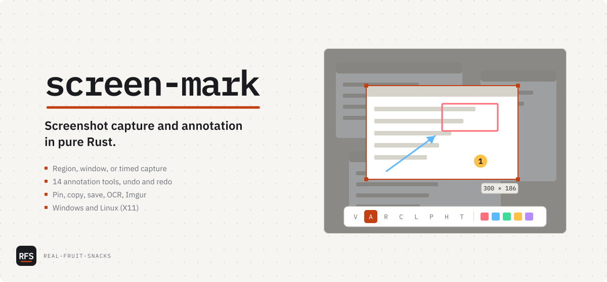

# screen-mark

Screenshot capture and annotation in pure Rust

<picture>
  <source media="(prefers-color-scheme: dark)" srcset="docs/assets/cover-dark.svg">
  
</picture>

Windows: download `screen-mark-vX.Y.Z-windows-x64.msi` (installer) or `.zip` (portable) from [Releases](https://github.com/Real-Fruit-Snacks/screen-mark/releases/latest). Linux: `screen-mark-vX.Y.Z-linux-x64.tar.gz` from the same page. Or build it:

```sh
cargo install --git https://github.com/Real-Fruit-Snacks/screen-mark --locked
```

I wanted a screenshot tool that starts in under a second, draws an arrow without a round trip through a web view, and leaves no background service I didn't ask for. This is that: `winit` for windows, `tiny-skia` for drawing, a tray icon, two global hotkeys, and a TOML file. It assumes Windows 10 or later; the Linux build captures under X11 and nothing else yet.

## What's in it

| Command | Does |
|---|---|
| `screen-mark` | Starts in the tray. `Ctrl+PrintScreen` saves a PNG of the monitor under the mouse and copies it, in one press. `Ctrl+Shift+S` opens the capture overlay |
| `screen-mark capture --clipboard` | Captures the full screen to the clipboard, no UI |
| `screen-mark capture --save out.png` | Captures the full screen to a file, no UI |
| `screen-mark capture --delay 5` | Waits five seconds, then opens the overlay; add a flag above to skip it |
| `screen-mark install` / `uninstall` | Copies the exe to AppData with a Start Menu entry and PATH; the portable exe asks before doing this |

The one-press screenshot saves to `Pictures\screen-mark` (or the folder you pick in Settings › Capture) under a timestamped name that never overwrites, then puts the same image on the clipboard. A small popup in the corner says what happened; click it to open the folder with the file selected. Settings › Capture can switch the popup to system notifications or turn it off; errors always show.

In the overlay: drag for a region, click for a window, `Escape` cancels. `Enter` or `Ctrl+C` copies the selection with annotations, `Ctrl+S` saves, `Ctrl+Z` / `Ctrl+Shift+Z` undo and redo, scroll wheel changes tool size. From the toolbar: pin the capture as an always-on-top window, upload it anonymously to Imgur (needs your own client ID, see Configuration), or run Windows OCR on it and copy the text. The last 20 captures are kept in a History window. Two switches in Settings › Capture change the region flow: *Save a file every time I copy* writes a PNG alongside each copy, and *Copy as soon as a region is drawn* skips the markup toolbar so drag-and-release is the whole job.

Fourteen annotation tools, one key each:

| Key | Tool | Key | Tool |
|---|---|---|---|
| `V` | Select / move | `H` | Highlight (multiply blend) |
| `A` | Arrow | `F` | Spotlight |
| `R` | Rectangle | `T` | Text (`Ctrl+V` pastes) |
| `C` | Circle | `B` | Pixelate |
| `O` | Rounded rectangle | `N` | Step marker, auto-numbered |
| `L` | Line | `I` | Eyedropper |
| `P` | Pencil | `M` | Measurement |

Every key above is rebindable in Settings › Keys: click a binding, press the new combination. `Esc` cancels, `Backspace` leaves it unbound. Settings refuses a combination another binding already uses, one Windows keeps for itself (`Alt+Tab`, `Win+L`, ...), or a global hotkey another app has registered, and says which. A global hotkey with a single modifier (`Alt+S`) or a bare F-key is allowed, with a note that other apps won't see it while screen-mark runs. Pin, upload, and OCR start unbound and can be given keys there too.

Dark and light modes, switched in Settings › General or with `theme` in the config file. Five annotation color presets (red, blue, green, yellow, mauve) or any `#rrggbb`.

## Tested on

- Windows 11 · Rust stable — my daily machine, every release used in anger before tagging
- Windows Server 2025 · Rust stable — CI (`windows-latest`) builds, tests, and runs clippy on every push
- Ubuntu 24.04 · X11 · Rust stable — CI (`ubuntu-latest`) builds and tests, then drives the real binary on a virtual X display with two monitors (`tests/e2e/`): hotkeys, popups, rebinding, the tray menu, unwritable folders, system notifications
- *Not* tested: Wayland — the backend is a stub and capture does nothing. macOS — does not build.

## Known issues

- Upgrading from HydroShot 1.x: config, history, and the autostart entry are migrated on first run. The old self-installed copy is not removed; run `hydroshot uninstall` once, or let the 2.0 MSI replace the 1.x MSI.
- Linux capture is X11 only and experimental; multi-monitor and HiDPI are not verified there.
- OCR is Windows only. It shells out to PowerShell and the Windows.Media.Ocr API, so the OCR language pack for your display language has to be installed.
- Imgur upload ships with no client ID. Register one at api.imgur.com and set it in Settings or `SCREEN_MARK_IMGUR_CLIENT_ID`.
- Window capture skips cloaked UWP windows on purpose; some Store apps will not be selectable by click.
- CLI `--delay` waits silently. The on-screen countdown only appears for tray-menu delays.
- `Ctrl+PrintScreen` is already taken on some machines (Greenshot, ShareX, and some keyboard utilities register it). screen-mark shows a popup when a hotkey can't be registered; click it to pick another in Settings › Keys.
- Linux: `screen-mark capture --clipboard` loses the image when the command exits, because X11 clipboards live in the owning process. The tray app's clipboard is fine.

## Configuration

Written on first run to `%APPDATA%\screen-mark\config.toml` (Windows) or `~/.config/screen-mark/config.toml` (Linux). Every key is optional; missing keys take the defaults below. Set `SCREEN_MARK_HOME` to keep the config and history in one folder of your choosing instead (portable use; the test suite uses it too).

```toml
[general]
default_color = "blue"        # red | blue | green | yellow | mauve | "#rrggbb"
default_thickness = 3.0
save_directory = ""           # where captures go; empty means Pictures/screen-mark
ask_where_to_save = true      # Ctrl+S opens a PNG/JPEG/WebP dialog; false saves straight to the folder
                              # (left unset, it asks only while save_directory is empty)
copy_also_saves = false       # every copy also writes a PNG to save_directory
finish_on_release = false     # copy as soon as a region is drawn, no markup toolbar
screenshot_area = "monitor"   # monitor (under the mouse) | all
notifications = "toast"       # toast | system | off; errors always show
imgur_client_id = ""          # or SCREEN_MARK_IMGUR_CLIENT_ID in the environment
history_enabled = true
theme = "dark"                # dark | light

[hotkey]                      # global; "" leaves one unbound
region = "Ctrl+Shift+S"       # was `capture` in 2.0; that name still works
screenshot = "Ctrl+PrintScreen"

[keys]                        # while marking up
copy = "Ctrl+C"
save = "Ctrl+S"
undo = "Ctrl+Z"
redo = "Ctrl+Shift+Z"
select_all = "Ctrl+A"
pin = ""
ocr = ""
upload = ""

[shortcuts]                   # one key per tool; defaults are the table above
select = "v"

[toolbar]                     # hide tools you never use
measurement = false
```

Source layout, for the curious: `src/capture/` has one backend per platform, `src/tools/` has one file per annotation tool, `src/overlay/` is the selection UI, and `src/state.rs` holds the annotation command stack that undo and redo replay. `docs/` is the [website](https://real-fruit-snacks.github.io/screen-mark/), deployed by `pages.yml` on every push to `main`; `.gitlab-ci.yml` does the same on GitLab for air-gapped hosting.

## License

MIT
